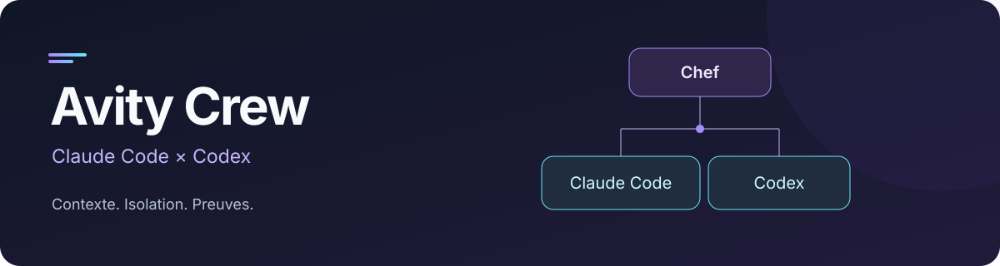

<div align="center">



**Un objectif. Une équipe Claude Code + Codex. Des livrables vérifiables.**

[](https://github.com/AVTAVANTTOUT2/avity-crew/actions/workflows/check.yml)
[](https://github.com/AVTAVANTTOUT2/avity-crew/releases)
[](https://nodejs.org/)
[](LICENSE)

[Démarrer](#installation-et-premier-objectif) · [Documentation](#documentation) · [Contribuer](CONTRIBUTING.md) · [Changelog](CHANGELOG.md)

</div>

Application locale de terminal pour coordonner Claude Code et Codex sur un projet.
Vous fournissez un objectif et des critères observables ; un chef configurable
organise les missions, les contextes, les revues et les preuves conservées localement.

Le but : travailler avec plusieurs agents sur un même projet, tout en gardant
une trace claire de **qui a fait quoi, sur quelle version et avec quels contrôles**.

## Ce que vous pouvez faire

| Besoin                           | Avity Crew                                                                                     |
| -------------------------------- | ---------------------------------------------------------------------------------------------- |
| Faire travailler les deux outils | Chef Claude ou Codex, sessions natives distinctes et missions contextualisées                  |
| Éviter les collisions            | Worktrees Git isolés, scopes de travail et ressources attribuées                               |
| Garder le fil                    | Objectifs, décisions, questions, sessions et preuves persistés dans SQLite                     |
| Contrôler une livraison          | Candidat combiné, tests et revues indépendantes liés à la version livrée                       |
| Revenir plus tard                | Vue détachable, pause et reprise explicites ; le service reste actif après fermeture de la vue |
| Travailler sans dépôt            | Mode documentation avec empreintes de fichiers, sans création automatique d'un dépôt Git       |

Prérequis : **Node ≥ 24.15**, référence **24.22.1** dans `.nvmrc`, npm 11 et Git
pour les missions de code. Claude Code et Codex doivent être installés et connectés
avec leurs comptes natifs. Avity Crew ne demande pas de clé API et ne modifie pas
leur connexion. Versions qualifiées séparément : Claude Code **2.1.304**, Codex
CLI **0.163.0** sur macOS ; les autres versions restent à vérifier.

## Installation et premier objectif

Téléchargez le fichier `.tgz` depuis les [releases](https://github.com/AVTAVANTTOUT2/avity-crew/releases), puis installez-le :

```sh
npm install --global --prefix "$HOME/.local" "/chemin/avity-crew-0.1.0.tgz"
export PATH="$HOME/.local/bin:$PATH"
avity-crew --help
```

Vous pouvez aussi construire le paquet depuis les sources :

```sh
git clone https://github.com/AVTAVANTTOUT2/avity-crew.git
cd avity-crew
npm ci
npm run check
npm pack
```

Puis donnez un premier objectif :

```sh
cd "/chemin/mon projet"
avity-crew init
avity-crew run "Rédiger un guide de démarrage" \
  --criterion "Le guide décrit les prérequis et une procédure vérifiable" \
  --constraint "Ne rien publier à l'extérieur" \
  --chief codex --max-agents 2 --mode documentation
```

`init` prépare le service sans lancer de modèle ; `run` utilise réellement les
CLI et les ressources de vos comptes. En terminal interactif, la commande rejoint
la conversation du run créé. `q` ou Ctrl+C détachent la vue ; le service continue.
Sans terminal, utiliser `status --json` ou `watch` pour suivre le résultat.

Pour du code neuf, `--mode code --init-git` autorise explicitement une base Git.
Le mode documentation n'initialise pas Git. Une éventuelle `.avity-crew.json`
est relue au démarrage du service : voir la [configuration](docs/INSTALLATION.md#configuration-avant-le-premier-lancement).
Une livraison de code acceptée reste sur une référence dédiée ; elle n'avance pas
automatiquement votre dossier principal et n'est pas poussée sur un serveur.

## Documentation

- [Installer, configurer, sauvegarder](docs/INSTALLATION.md)
- [Utiliser la conversation, les commandes et la reprise](docs/USAGE.md)
- [Référence CLI](docs/CLI.md), [contexte](docs/CONTEXT.md), [workspaces](docs/WORKSPACE.md)
- [Adaptateur Claude](docs/providers/claude.md), [adaptateur Codex](docs/providers/codex.md)
- [Développer un adaptateur](docs/ADAPTERS.md), [exemple de mission documentaire](docs/examples/documentation-run.md)
- [Changelog](CHANGELOG.md)
- [Contribuer et préparer une version](CONTRIBUTING.md), [signaler une vulnérabilité](SECURITY.md)

## Validation réelle

**0.1.0 a été qualifiée localement sur macOS arm64**, avec des parcours réels
Claude/Codex, une installation du paquet et une conservation des données après
réinstallation. Le [rapport de recette](https://github.com/AVTAVANTTOUT2/avity-crew/blob/146277aa82840de3b66d5e3e16c45bacde39df66/avity-crew-workpack/validation/RELEASE_REPORT.md)
précise la source, le paquet et les scénarios historiques concernés.

| Périmètre                             | Preuve et portée                                                                                                              | Limite                                                                    |
| ------------------------------------- | ----------------------------------------------------------------------------------------------------------------------------- | ------------------------------------------------------------------------- |
| Socle et adaptateurs                  | Livraisons L00–L06 acceptées, avec essais natifs distincts Claude/Codex                                                       | Une recette d'adaptateur ne prouve pas toute l'orchestration              |
| Domaine, transport, CLI et reprise    | Tests locaux avec SQLite, HTTP, Git et processus POSIX ; fournisseurs simulés identifiés                                      | Une simulation ne démontre pas le comportement d'un modèle natif          |
| Charge de sept places                 | Banc simulé : chef actif, six workers actifs, septième worker en file puis lancé après libération d'une place ; arrêt observé | Zéro CLI LLM dans ce banc ; aucune acceptation métier forcée              |
| Recette native et distribution finale | Recettes mixtes locales Claude/Codex et paquet installé, détaillés dans le rapport historique                                 | Ne pas réutiliser une preuve ancienne comme qualification du paquet final |
| Plateformes                           | Recette native macOS arm64 ; CI Linux Node 24/26 distincte des essais providers                                               | Recettes natives Linux, Windows et WSL à effectuer                        |

Le service capture désormais les documents demandés par chemin et calcule leurs
empreintes. Une correction de plan par `amend_task` est auditée et invalide les
anciennes autorités de la tâche. La clôture exige les livraisons et preuves de
contrôle applicables à la révision actuelle ; ni une sortie native réussie ni un
texte « terminé » ne remplacent cette vérification.

## Développement

```sh
npm ci
npm run check
npm pack
```

Le paquet racine regroupe les modules compilés. Les workspaces privés exportent
leurs sources pour le développement ; les imports relatifs préservent la
topologie lors du build. `npm run build` génère les contrats puis compile l'ESM ;
ne pas éditer `packages/contracts/src/generated`. `npm pack` prépare un fichier
local, sans publication externe.

`check` vérifie les types, le format, la compilation et les tests. Les releases
GitHub sont automatisées via des PR de version ; le projet n'est pas publié
automatiquement sur npm. Le badge CI indique les contrôles distants et ne
remplace pas une recette avec les providers natifs.

## Licence

[MIT](LICENSE) — contributions et retours bienvenus.
