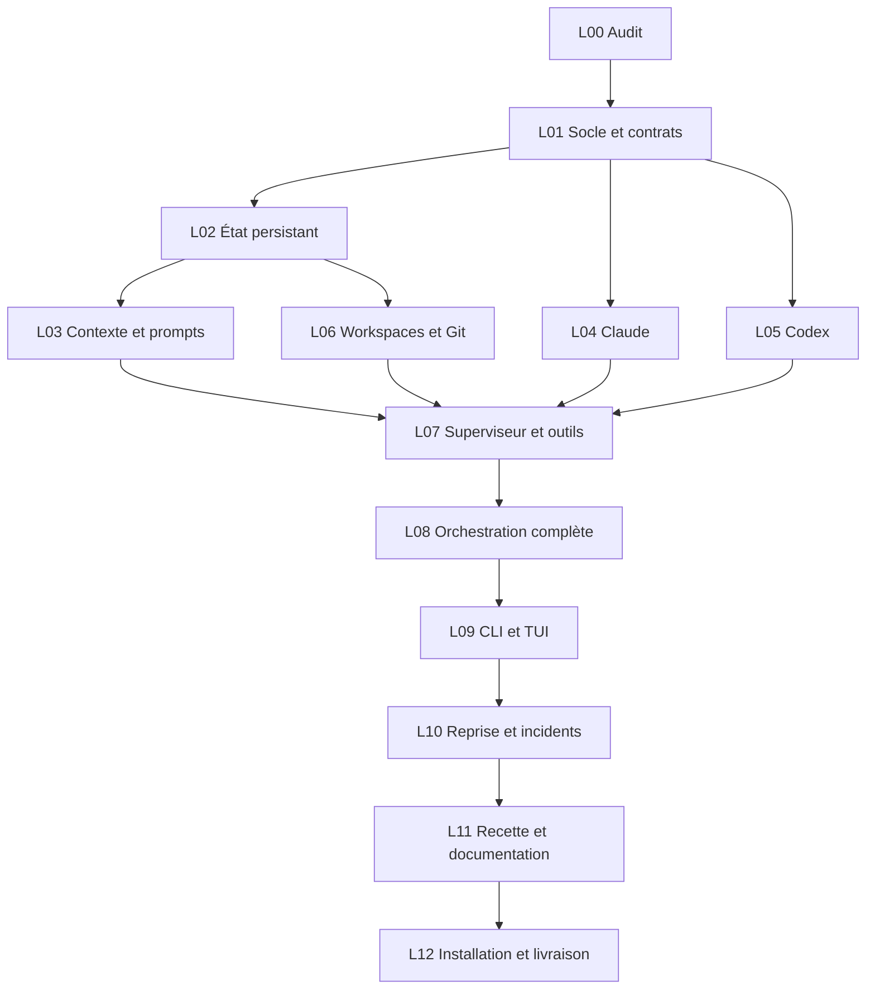

# Roadmap de construction — 13 lots

L'état initial de tous les lots est **à réaliser**. Le tableau ci-dessous décrit les dépendances ; l'état réel est obtenu avec `python3 scripts/coordination.py status` depuis ce dossier. Le registre empêche la prise d'un lot dont les dépendances ne sont pas acceptées.

## Lots et dépendances

| Lot | Objet | Dépendances |
| --- | --- | --- |
| [L00](lots/L00-audit.md) | Audit du dépôt et cadrage | Aucune |
| [L01](lots/L01-socle-contrats.md) | Socle, contrats et CI minimale | L00 |
| [L02](lots/L02-etat-persistant.md) | État persistant et journal | L01 |
| [L03](lots/L03-contexte-prompts.md) | Contexte, mémoire et prompts | L02 |
| [L04](lots/L04-claude.md) | Adaptateur Claude Code | L01 |
| [L05](lots/L05-codex.md) | Adaptateur Codex | L01 |
| [L06](lots/L06-workspaces-git.md) | Workspaces, Git et ressources | L02 |
| [L07](lots/L07-superviseur-outils.md) | Superviseur et outils de coordination | L03, L04, L05, L06 |
| [L08](lots/L08-orchestration.md) | Orchestration de bout en bout | L07 |
| [L09](lots/L09-cli-tui.md) | CLI et interface terminal | L08 |
| [L10](lots/L10-reprise-resilience.md) | Reprise et résilience | L09 |
| [L11](lots/L11-recette-documentation.md) | Recette complète et documentation | L10 |
| [L12](lots/L12-release.md) | Installation et livraison finale | L11 |

## Ordre et parallélisme

Après L01, trois chantiers principaux avancent ensemble : état persistant, Claude et Codex. Après L02, contexte et espaces de travail peuvent avancer simultanément. Les contrats communs sont intégrés avant ces branches.

Les rôles sont adaptés aux missions : un agent peut écrire, un autre relire, un autre préparer les tests. Le coordinateur réserve les lots, découpe les sous-tâches et gère leurs interfaces. Une préparation indépendante est possible avant l'acceptation d'une dépendance, mais elle ne permet pas de déclarer cette dépendance satisfaite.

## Jalons

- **M1 — Contrats stables** : L00–L01 acceptés ; périmètre, chemins et versions fixés.
- **M2 — Briques éprouvées** : état, contexte, providers et workspaces prêts. Les adaptateurs prouvent leur mécanisme d'outil avec un bridge minimal de test ; le bridge complet arrive en L07.
- **M3 — Première boucle réelle** : fin L08, un chef et deux exécutants mixtes accomplissent une mission, corrigent un défaut et produisent une livraison vérifiée.
- **M4 — Usage quotidien** : fin L10, interface, fermeture/réouverture, reprise et changement de chef fonctionnent.
- **M5 — V1 livrée** : L11–L12, recette réelle, package installable, documentation et limites observées.

## Conditions de progression

Chaque fiche définit ses entrées, son périmètre, ses réalisations, ses preuves et sa passation. Aucune estimation de durée ne remplace ces critères. Les recettes réelles restent distinctes des simulations. Une absence d'accès est un blocage à documenter, pas un succès à présumer.

Le changelog est consolidé après acceptation. La matrice [docs/TRACEABILITY.md](docs/TRACEABILITY.md) permet de retrouver les lots et critères qui couvrent chaque exigence.
